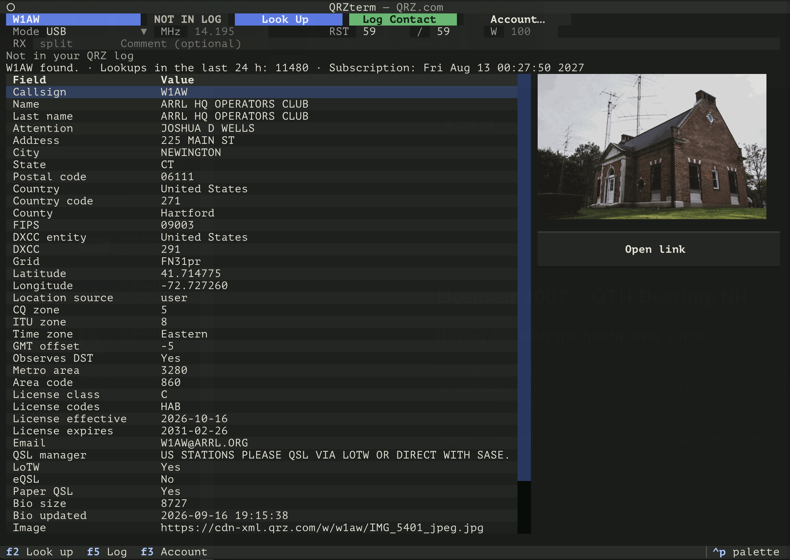

# QRZterm

A terminal app for [QRZ.com](https://www.qrz.com/) callsign lookup and logging, for macOS and Linux. Type a callsign, see the station record and photo, check whether you have worked them, and log the contact.



Version 0.30 · Licensed under the [GPL-3.0](LICENSE).

The lookup, the worked check, and the log upload follow the QRZ tab in [590Ctrl](https://github.com/kingsqueak/590Ctrl). Frequency and mode are typed, or follow the radio over [TCI](#follow-the-radio-over-tci). Power is typed.

## Install

Python 3.12 or newer.

```sh
git clone https://github.com/kingsqueak/QRZterm.git
cd QRZterm
sudo ./install.sh
```

The script builds a private virtual environment at `/usr/local/lib/qrzterm` and links the command to `/usr/local/bin/qrzterm`. That directory is on the default PATH on macOS and on most Linux systems, so `qrzterm` then runs from any directory. The launcher uses the environment's Python, so the system Python is left alone.

```sh
qrzterm
qrzterm W1AW
```

`qrzterm W1AW` looks that call up as soon as the window opens.

Install somewhere else by setting `PREFIX`. The command is then `$PREFIX/bin/qrzterm`:

```sh
sudo -E PREFIX=/opt/qrzterm ./install.sh
```

Run the script again after pulling changes. It upgrades the installed copy. Remove the install by deleting `/usr/local/bin/qrzterm` and `/usr/local/lib/qrzterm`.

On Debian or Ubuntu, install `python3-venv` first if `python3 -m venv` says the venv module is missing.

## What you can do

- Type a callsign and press Enter, or **Look Up** (F2). A banner shows the name, QTH, grid, DXCC entity and zones, the station's local time, and which QSL methods it uses. With your station grid set under Account, it also shows the distance and beam heading. Every field QRZ returns is listed below the banner in two tables, grouped by operator, address, on the air, license, QSL, and QRZ record. LoTW, eQSL, and paper QSL show as Yes or No.
- The station photo is drawn beside the banner when QRZ sends an image URL. **Open link** opens the callsign page, an email address, a web page, or the image, from the row picked in either table.
- With a logbook API key, each lookup checks your QRZ log. A call you have worked turns the callsign and the badge green and shows the date, band, and mode of the last QSO, plus how many you have logged. Otherwise the badge says **NOT IN LOG**.
- **Log Contact** (F5) uploads the QSO. The band comes from the frequency. USB and LSB are logged as SSB with that sideband. FT4 is logged as MFSK FT4, and PSK31 as PSK PSK31. The time is the current UTC time. Name, city, grid, DXCC, state, county, and zones are copied from the lookup when it is the same call.
- A whole number of 1000 or more in the frequency box is read as kilohertz (`14074`). A number with a decimal point is megahertz (`14.195`). **RX** is the receive frequency when you are split. Leave it blank otherwise.
- **Account…** (F3) holds the QRZ username and password, the station callsign, your station grid, and the logbook API key.
- **Radio…** (F4) turns on following the radio over TCI.

Lookups use the [QRZ XML data service](https://www.qrz.com/docs/xml/current_spec.html). Without an XML subscription, QRZ returns only part of each record. Logging uses the [Logbook API](https://www.qrz.com/docs/logbook/QRZLogbookAPI.html) and needs a QRZ subscription. The key is under the logbook's Settings, then API. Each station callsign has its own logbook and key.

## Follow the radio over TCI

QRZterm can read the frequency and mode from anything that serves TCI, such as ExpertSDR, Zeus, or 590Ctrl. Open **Radio…** (F4), check **Follow the radio**, and enter the address. ExpertSDR's default is `localhost:40001`, and a port of 40001 is assumed if you leave it off. The label beside the comment box shows the link: the device name when connected, `TCI no link` while it retries every few seconds, or `TCI off`.

QRZterm only listens. It sends no TCI commands, so it can't tune or key the radio. It reads the first receiver only.

- **MHz** follows VFO A, and the band follows from that. When split is on, **MHz** is the transmit frequency and **RX** is VFO A. **RX** is cleared when split goes off.
- **Mode** follows the radio. CWL and CWU are logged as CW, SAM as AM, and NFM as FM. SPEC, DRM, DSB, and WFM leave the Mode box as it was.
- DIGU and DIGL don't say which digital mode is on the air. A digital mode already in the Mode box stays there. Otherwise the last digital mode you picked is used, starting with FT8, so check it when you are on something else.
- A field changes only when the radio changes, so a hand edit stands until you tune or change mode. A frequency box you are typing in is left alone until you leave it.
- The RST boxes follow the mode as they do when you pick one by hand. Power is still typed.

## Account file

Settings are stored in `~/.config/qrzterm/config.json` (`$XDG_CONFIG_HOME/qrzterm/config.json` when that is set). The file is mode `0600`. A remembered password is saved unencrypted, the same way 590Ctrl stores it. Uncheck **Remember password** to keep the password for this session only.

## Photos

Photos are drawn with [textual-image](https://github.com/lnqs/textual-image). It asks the terminal which graphics protocol it has, and then picks:

| Terminal | How the photo is drawn |
| --- | --- |
| iTerm2, WezTerm, foot, Konsole, xterm (Sixel on), Windows Terminal, VS Code terminal | Sixel |
| Kitty | Kitty graphics protocol |
| Terminal.app, GNOME Terminal, and other Unicode terminals | Unicode half-blocks |

Half-blocks are a full-color approximation, so the photo still shows where the terminal has no graphics protocol. Warp does not render this library's graphics reliably. Run with `--image halfcell` there.

```sh
qrzterm --image halfcell
```

`QRZTERM_IMAGE` sets the same choice (`auto`, `halfcell`, `unicode`, `sixel`, or `tgp`).

## Develop

```sh
python3 -m venv .venv
source .venv/bin/activate
pip install -e ".[dev]"
pytest
```

## License

GPL-3.0-or-later. Copyright 2026 KC2RGW Chris Esser.
